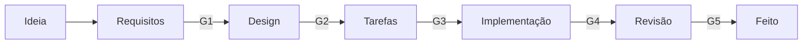

# Rabisco — Repositório de Especificações e Governança

Repositório `rabisco-studio/platform` da organização **Rabisco Studio**.

**Rabisco** é uma plataforma de arte digital híbrida (raster + vetor), feita no Brasil: núcleo em Rust, renderização na GPU, clientes Flutter e web, backend Java/Spring Boot. O projeto segue um modelo **waterfall com portões de aprovação**, executado por **Spec-Driven Development (SDD)**: primeiro se especifica tudo, depois se constrói.

> **Estado atual:** este repositório contém **especificações, decisões de arquitetura, contratos e governança**. Ainda **não há código de produto**: ele entra neste mesmo repositório (pastas `core/`, `backend/`, `clients/`) só depois que cada spec passar pelo gate G3. A cobertura real, por release e por spec, está em [docs/requirements/coverage.md](docs/requirements/coverage.md).

Este README é o **guia de entrada**: quem acabou de chegar à organização deve conseguir entender aqui como tudo funciona. Os detalhes de cada assunto estão nos documentos linkados.

---

## Índice

1. [Comece por aqui (primeiro dia)](#1-comece-por-aqui-primeiro-dia)
2. [A organização e as equipes](#2-a-organização-e-as-equipes)
3. [Mapa do repositório](#3-mapa-do-repositório)
4. [Como o trabalho flui (o método)](#4-como-o-trabalho-flui-o-método)
5. [Colaboração no dia a dia](#5-colaboração-no-dia-a-dia-branches-commits-e-pull-requests)
6. [Issues](#6-issues)
7. [O quadro (GitHub Projects)](#7-o-quadro-github-projects)
8. [Labels](#8-labels)
9. [Milestones](#9-milestones)
10. [Releases e baselines](#10-releases-e-baselines)
11. [Mudanças em documentos aprovados](#11-mudanças-em-documentos-aprovados-change-request)
12. [Decisões, riscos e ADRs](#12-decisões-riscos-e-adrs)
13. [Templates](#13-templates)
14. [Automação e verificação](#14-automação-e-verificação)
15. [Receitas: "como eu faço…?"](#15-receitas-como-eu-faço)
16. [Problemas comuns](#16-problemas-comuns)
17. [Glossário rápido](#17-glossário-rápido)
18. [Regras de ouro e o que nunca fazer](#18-regras-de-ouro-e-o-que-nunca-fazer)
19. [Licença, atribuição e segurança](#19-licença-atribuição-e-segurança)

---

## 1. Comece por aqui (primeiro dia)

Faça nesta ordem. Cada item leva poucos minutos; o conjunto leva cerca de duas horas.

- [ ] **Aceite o convite** da organização `rabisco-studio` e confirme em quais equipes você entrou (seção 2).
- [ ] **Instale o Python 3** (é a única dependência) e rode, dentro do repositório clonado: `make verify`. O resultado esperado é `sdd-check: 0 erro(s), 0 aviso(s)`. Sem `make` (comum no Windows), rode os dois comandos que ele chama: `python3 tools/sdd/generate.py` e depois `python3 tools/sdd/sdd_check.py`.
- [ ] **Leia, nesta ordem:** este README → [Charter do projeto](docs/governance/project-charter.md) → [Fluxo da equipe](docs/governance/team-workflow.md) → [Constituição](docs/constitution.md) (os princípios P-01 a P-11) → [Glossário](docs/governance/glossary.md).
- [ ] **Leia os documentos do seu papel:**

| Se você é…                | Leia também                                                                                                                                                                                                                      |
| ------------------------- | -------------------------------------------------------------------------------------------------------------------------------------------------------------------------------------------------------------------------------- |
| Product Owner             | [Catálogo de requisitos](docs/requirements/requirements-catalog.csv) · [Cobertura](docs/requirements/coverage.md) · [Decisões](docs/governance/decision-log.md)                                                                  |
| Arquiteto                 | [ADRs](docs/adr/README.md) · [Crates](docs/architecture/crates.toml) · [Propriedade](docs/architecture/ownership-matrix.md) · [Contratos](contracts/README.md)                                                                   |
| Tech lead / autor de spec | [AGENTS.md](AGENTS.md) · [Índice de specs](.ai/sdd/INDEX.md) · [Templates](docs/templates/README.md) · [Revisão de gate](docs/templates/gate-review-template.md)                                                                 |
| Gestão / PMO              | [RACI](docs/governance/raci.md) · [Riscos](docs/governance/risk-register.md) · [Cronograma](docs/governance/schedule-wbs.md) · [Mudanças](docs/governance/change-control.md) · [Guia do GitHub](docs/governance/github-setup.md) |
| QA                        | [Plano de testes](docs/templates/test-plan-template.md) · [Qualidade](.ai/steering/quality.md)                                                                                                                                   |

- [ ] **Abra um PR de teste** pequeno (por exemplo, corrigir um erro de digitação ou acrescentar um termo ao glossário) para passar uma vez pelo fluxo completo (seção 5). Use o [checklist de onboarding](docs/templates/onboarding-checklist-template.md) como roteiro.
- [ ] **Entenda que autor nunca aprova o próprio trabalho** e que arquivos gerados nunca são editados à mão (seção 18).

---

## 2. A organização e as equipes

**Organização no GitHub:** `rabisco-studio` (nome de exibição: Rabisco Studio). Todo o trabalho do projeto acontece em um repositório só, o **monorepo** `rabisco-studio/platform`. Mais repositórios (infraestrutura, SDK de plugins) só existirão quando forem necessários, a partir do R2 e do R5.

**Convites e acesso:** as pessoas são convidadas **pelas equipes**, nunca individualmente. A equipe define o que cada um pode aprovar (via [CODEOWNERS](.github/CODEOWNERS)).

| Equipe          | Papel                        | Aprova / é dona de                                                                     | Sobre                                                         |
| --------------- | ---------------------------- | -------------------------------------------------------------------------------------- | ------------------------------------------------------------- |
| `architects`    | Arquitetos                   | `contracts/`, `docs/adr/`, `docs/architecture/`, `.ai/steering/`, constituição, spikes | Decisões técnicas; última palavra em conflitos de arquitetura |
| `tech-leads`    | Tech leads de área           | `.ai/sdd/specs/`, aprovação de tarefas (G3)                                            | Qualidade das specs                                           |
| `product`       | PO e analistas de requisitos | `docs/requirements/` (catálogos), gate de requisitos (G1) e de revisão (G5)            | Prioridades e escopo                                          |
| `pmo`           | Gestão do projeto            | `docs/governance/`, `.github/`, `tools/`, `Makefile`                                   | Processo, mudanças, riscos, cronograma                        |
| `core-leads`    | Leads do núcleo Rust         | `core/`                                                                                | Código, após o G3                                             |
| `backend-leads` | Leads do backend Java        | `backend/`                                                                             | Código, a partir do R2                                        |
| `client-leads`  | Leads de Flutter e web       | `clients/`                                                                             | Código dos clientes                                           |
| `qa`            | Qualidade                    | `tests/`, gates G4 e G5                                                                | Testes e critérios de aceite                                  |

Uma pessoa pode estar em várias equipes, mas **nunca aprova o que ela mesma escreveu**. A matriz completa de quem faz o quê (RACI) está em [docs/governance/raci.md](docs/governance/raci.md). Quem é dono de cada contrato, tipo e crate está em [docs/architecture/ownership-matrix.md](docs/architecture/ownership-matrix.md).

**Onde cada coisa vive no GitHub:**

| O quê                            | Onde                                                   |
| -------------------------------- | ------------------------------------------------------ |
| Código e documentos              | Repositório `rabisco-studio/platform`                  |
| Pedidos de trabalho e discussões | Aba **Issues** do repositório                          |
| Planejamento visual das specs    | **Projects** da organização: quadro "Rabisco Platform" |
| Marcos de entrega                | **Milestones** do repositório                          |
| Classificação das issues         | **Labels** do repositório                              |
| Versões congeladas               | **Tags** e **Releases** do repositório                 |
| Verificação automática           | Aba **Actions** (workflow `sdd-check`)                 |

---

## 3. Mapa do repositório

```
README.md                  Este guia
AGENTS.md                  Instruções para agentes de IA que trabalham no repositório
ATTRIBUTION.md             Atribuição do método (licença CC BY-NC-SA)
Makefile                   Comandos: make verify | docs | check | strict

docs/
  constitution.md          Os 11 princípios (P-01..P-11) que valem para tudo
  adr/                     Decisões de arquitetura (ADR-001..018) + índice gerado
  architecture/            crates.toml (dependências permitidas) e matriz de propriedade
  requirements/            Catálogos (fonte) + rastreabilidade e cobertura (gerados)
  governance/              Charter, RACI, mudanças, riscos, decisões, cronograma, glossário...
  templates/               Modelos de todos os documentos compartilhados

.ai/
  steering/                Contexto técnico permanente (produto, stack, princípios, núcleo...)
  sdd/
    PLAN.md                Roadmap por releases e fases
    INDEX.md               Índice de specs (gerado)
    specs/NNN-slug/        Uma pasta por spec: requirements, design, tasks, .status

contracts/                 Contratos legíveis por máquina: a fonte única das interfaces
spikes/                    Planos dos experimentos da Fase 0
tests/                     Reservada para testes (compat, e2e, graphics, integration, performance)
tools/sdd/                 sdd-check e o gerador de arquivos derivados

.github/
  CODEOWNERS               Quem aprova o quê, por pasta
  workflows/               CI (sdd-check)
  rulesets/                Regra de proteção da branch main (importável)
  ISSUE_TEMPLATE/          Formulários de issue
  PULL_REQUEST_TEMPLATE/   Templates de PR por tipo
```

**Onde acho…?**

| Procuro                               | Está em                                                                                                         |
| ------------------------------------- | --------------------------------------------------------------------------------------------------------------- |
| O que o produto deve fazer            | [docs/requirements/requirements-catalog.csv](docs/requirements/requirements-catalog.csv)                        |
| Todas as specs do plano               | [docs/requirements/spec-catalog.csv](docs/requirements/spec-catalog.csv) e [.ai/sdd/INDEX.md](.ai/sdd/INDEX.md) |
| Quanto já está especificado           | [docs/requirements/coverage.md](docs/requirements/coverage.md)                                                  |
| De qual spec um requisito vem         | [docs/requirements/traceability.csv](docs/requirements/traceability.csv)                                        |
| Por que uma decisão foi tomada        | [docs/adr/README.md](docs/adr/README.md)                                                                        |
| Formato de arquivo, operações, pincel | [contracts/](contracts/README.md)                                                                               |
| Fases e releases                      | [.ai/sdd/PLAN.md](.ai/sdd/PLAN.md)                                                                              |
| Dúvidas e decisões pendentes          | [docs/governance/decision-log.md](docs/governance/decision-log.md)                                              |
| Riscos                                | [docs/governance/risk-register.md](docs/governance/risk-register.md)                                            |

**Fonte única:** cada fato mora em **um** lugar (catálogos, `crates.toml`, o DDL do formato, os contratos). Os documentos apontam para ele, não o copiam. Se você encontrar o mesmo fato escrito em dois lugares, é um defeito: abra uma issue.

**Arquivos gerados** (nunca edite à mão; o `make docs` os recria): `.ai/sdd/INDEX.md`, `docs/requirements/coverage.md`, `docs/requirements/traceability.csv` e `docs/adr/README.md`.

---

## 4. Como o trabalho flui (o método)

O projeto é dividido em **specs** (especificações). Cada spec é uma pasta `NNN-slug` em `.ai/sdd/specs/` e passa por **fases com portões (gates)**. Só se avança para a fase seguinte com a **aprovação de uma pessoa diferente do autor**.



| Gate   | Documento         | O que precisa estar pronto                                                         | Quem aprova (nunca o autor) | `.status` depois        |
| ------ | ----------------- | ---------------------------------------------------------------------------------- | --------------------------- | ----------------------- |
| **G1** | `requirements.md` | Requisitos em EARS, cada um com `Cobre:`, critérios de aceite, sem pergunta aberta | PO + tech lead              | `requirements:approved` |
| **G2** | `design.md`       | Todo requisito mapeado a um componente; contratos e ADRs citados                   | Arquiteto                   | `design:approved`       |
| **G3** | `tasks.md`        | Tarefas de 1 a 4 h, todo requisito coberto, dependências sem ciclo                 | Tech lead                   | `tasks:approved`        |
| **G4** | Implementação     | Tarefas concluídas, testes verdes, metas medidas                                   | Tech lead + QA              | `implementation:done`   |
| **G5** | Revisão           | Critérios de aceite verificados, rastreabilidade fechada                           | PO                          | `review:done`           |

**O arquivo `.status` é a fonte única do estágio de uma spec.** Ele tem uma linha só (por exemplo, `requirements:draft`). Regras:

- Um estado `*:draft` **nunca** libera a fase seguinte. Só uma aprovação humana, registrada em PR, muda o `.status`.
- Mudar um documento **já aprovado** reabre o portão (veja a seção 11).
- O `sdd-check` falha se o `.status` e os cabeçalhos dos documentos discordarem.

**Rigor por tipo de spec:**

- **`anchored`:** contratos, formatos, sincronização, segurança e privacidade. Formalidade máxima.
- **`spec-first`:** interface, ferramentas, pincéis, filtros. Formalidade menor.
- Se houver dúvida, vale `anchored`.

**Releases e fases do produto:**

| Release         | Fases | O que entrega                                                         |
| --------------- | ----- | --------------------------------------------------------------------- |
| R1 Local Studio | 1 a 4 | Editor híbrido desktop e offline                                      |
| R2 Cloud        | 5     | Conta, biblioteca, versões e sincronização                            |
| R3 Collab       | 6     | Compartilhamento, colaboração em tempo real e comentários             |
| R4 Everywhere   | 7     | Mobile, web, acessibilidade e i18n                                    |
| R5 Pro          | 8     | Plugins, PSD, CMYK, editor de pincéis, filtros e tipografia avançados |

A **Fase 0** (fundações e spikes a–e) vem antes de tudo. Detalhes: [PLAN.md](.ai/sdd/PLAN.md) e [cronograma](docs/governance/schedule-wbs.md).

**Spikes:** são experimentos curtos (1 a 2 semanas) que produzem **decisão e números**, nunca código de produto. Os cinco spikes estão em [spikes/](spikes/README.md).

**Identificadores:** `US-` história, `AC-` critério de aceite, `FR-`/`NFR-` requisito da spec, `RF-`/`RNF-` requisito global do catálogo, `T-` tarefa, `D-` decisão local, `Q-` pergunta aberta, `ADR-` decisão de arquitetura, `DEC-` decisão do projeto, `RSK-` risco, `SPEC-` spec. IDs removidos nunca são reutilizados.

---

## 5. Colaboração no dia a dia: branches, commits e pull requests

### Princípio: uma branch longa, muitas branches curtas

Existe **uma** branch permanente: a **`main`**. Ela é protegida e sempre passa no `make verify`. Todo trabalho acontece em **branches curtas** (horas ou poucos dias), uma por assunto, e termina em PR. Evite branches longas por equipe ou por área: elas se afastam da `main` e geram os conflitos que queremos evitar.

### Nomes de branch

| Tipo de trabalho               | Padrão                  | Exemplo                              |
| ------------------------------ | ----------------------- | ------------------------------------ |
| Documentos de uma spec         | `spec/NNN-slug/assunto` | `spec/001-scene-graph/ajuste-fr-003` |
| ADR                            | `adr/NNN-slug`          | `adr/019-cache-de-tiles`             |
| Governança, catálogos, tooling | `gov/assunto`           | `gov/atualiza-raci`                  |
| Contratos                      | `contracts/assunto`     | `contracts/tile-schema`              |
| Código (só após o G3)          | `feat/NNN-T-xxx`        | `feat/001-T-004`                     |
| Spike                          | `spike/x-nome`          | `spike/a-rust-wgpu`                  |

### Commits

Pequenos e com um assunto. Mensagem no padrão `PREFIXO: assunto`, com o prefixo `SPEC-NNN:`, `ADR-NNN:`, `GOV:` ou `contracts:`. Exemplo: `SPEC-001: mapeia FR-012 no design`. Faça `rebase` na `main` antes de abrir o PR.

### Pull request (PR)

1. **Um assunto por PR.** Título com o mesmo prefixo dos commits.
2. **Use o template do tipo certo** acrescentando `?template=<arquivo>` ao final do endereço de criação do PR:

| Tipo de PR                                             | Template                  |
| ------------------------------------------------------ | ------------------------- |
| Requirements, design ou tasks de uma spec              | `?template=spec.md`       |
| Aprovação de gate (altera o `.status`; só o aprovador) | `?template=gate.md`       |
| ADR                                                    | `?template=adr.md`        |
| Contratos ou `crates.toml`                             | `?template=contract.md`   |
| Governança, catálogos, tooling, documentação           | `?template=governance.md` |
| Código (após o G3)                                     | `?template=code.md`       |

3. **Rode `make verify`** antes de pedir revisão. O CI roda o mesmo comando e o PR não pode ser mesclado se ele falhar.
4. **Vincule a issue** no corpo do PR (`Closes #n`).
5. **Peça revisão** a alguém diferente de você. O GitHub sugere os revisores certos pelo `CODEOWNERS`.
6. **Resolva todos os comentários** antes do merge.
7. **Merge por squash** (é a única opção habilitada). A branch é apagada automaticamente depois.

### O que protege a `main`

A regra [main-protection.json](.github/rulesets/main-protection.json) impede: push direto, force push e apagar a branch; merge sem PR; merge sem a aprovação dos Code Owners; aprovar o último push do próprio autor; merge com o check `verify` falhando; histórico não linear. **Ninguém tem bypass, nem administradores.**

### Gates em PR

Aprovar um gate é fazer um **PR que altera o `.status`** (template `gate.md`), aberto pelo **aprovador**, com o preenchimento da [revisão de gate](docs/templates/gate-review-template.md). Depois do merge, o card da spec muda de coluna no quadro (seção 7).

---

## 6. Issues

**Issue em branco não existe:** use sempre um dos formulários de **Issues → New issue**. Eles têm campos obrigatórios que garantem que a informação necessária chegue.

| Situação                                        | Formulário                  | Prefixo do título  | Label            |
| ----------------------------------------------- | --------------------------- | ------------------ | ---------------- |
| Mudar algo já aprovado, contrato ou arquitetura | Change Request              | `[CR]`             | `change-request` |
| Pedir a aprovação de um gate G1 a G5            | Pedido de aprovação de gate | `[SPEC-NNN] G?:`   | `gate`           |
| Trabalho de implementação (só após o G3)        | Tarefa                      | `[SPEC-NNN T-NNN]` | `task`           |
| Experimento da Fase 0                           | Spike                       | `[SPIKE-x]`        | `spike`          |
| Pergunta que bloqueia gate ou decisão pendente  | Pergunta aberta             | `[Q]`              | `question`       |
| Erro em documento, contrato ou código           | Defeito                     | `[BUG]`            | `defect`         |

**Regras:**

1. Uma issue, um assunto, um responsável (_assignee_).
2. **Issue de tarefa só depois do G3.** Antes disso, as tarefas podem mudar.
3. A issue **copia** o ID e o checklist do `tasks.md`, mas **não muda o escopo**. Mudou o escopo? É uma Change Request.
4. Todo item aberto (pergunta ou decisão) tem **padrão recomendado e prazo**. Vencido o prazo, vale o padrão, e isso é registrado no [decision-log](docs/governance/decision-log.md).
5. Todo PR cita a sua issue.

Exemplos de título: `[SPEC-001 T-004] DocumentMeta e perfil de cor` · `[SPEC-002] G1: pedido de aprovação` · `[CR] Mover RF-03.9 do R1 para o R2` · `[Q] SPEC-001 Q-005: modelo de mesclagem`. Detalhes completos: [issue-conventions.md](docs/governance/issue-conventions.md).

---

## 7. O quadro (GitHub Projects)

O quadro **"Rabisco Platform"** fica na organização (aba **Projects** de `rabisco-studio`). Cada **card representa uma spec** (existem 37, de SPEC-001 a SPEC-037, tirados do [catálogo](docs/requirements/spec-catalog.csv)). Os cards são **rascunhos do quadro**, não issues: servem para acompanhar o andamento. O trabalho em si vive em **issues**. Só as **issues de tarefa** (label `task`, após o G3) entram no quadro, sozinhas e já em **Implementação**. Perguntas, defeitos, Change Requests e pedidos de gate **não entram no quadro**: são acompanhados na aba **Issues**. As automações do quadro (que só se configuram na interface) estão em [github-setup.md](docs/governance/github-setup.md), seção 4.3.

### Colunas (campo Status), na ordem

| #   | Coluna            | O que significa                          | `.status` correspondente                       | Sai quando                                |
| --- | ----------------- | ---------------------------------------- | ---------------------------------------------- | ----------------------------------------- |
| 1   | **Ideia**         | Spec planejada, ainda sem pasta nem dono | (sem pasta)                                    | A pasta é criada com `requirements:draft` |
| 2   | **Requisitos**    | Escrevendo `requirements.md`             | `requirements:draft`                           | G1 aprovado                               |
| 3   | **Design**        | Escrevendo `design.md`                   | `requirements:approved`, `design:draft`        | G2 aprovado                               |
| 4   | **Tarefas**       | Escrevendo `tasks.md`                    | `design:approved`, `tasks:draft`               | G3 aprovado                               |
| 5   | **Implementação** | Código e testes em andamento             | `tasks:approved`, `implementation:in-progress` | G4 aprovado                               |
| 6   | **Revisão**       | Verificando critérios de aceite          | `implementation:done`                          | G5 aprovado                               |
| 7   | **Feito**         | Spec concluída e congelada               | `review:done`                                  | (só reabre por Change Request)            |

**Regras do quadro:** o card só muda de coluna junto com o PR que altera o `.status`. Um estado `*:draft` nunca avança o card sozinho. Se um gate for reaberto, o card **volta** para a coluna da fase reaberta.

### Campos de cada card

| Campo       | Valores                  | Para quê                |
| ----------- | ------------------------ | ----------------------- |
| **Spec**    | `SPEC-001` a `SPEC-037`  | Liga o card ao catálogo |
| **Release** | R1 a R5                  | Filtrar por entrega     |
| **Fase**    | 0 a 8                    | Ordem do cronograma     |
| **Rigor**   | `anchored`, `spec-first` | Nível de formalidade    |
| **Dono**    | Pessoa responsável       | Quem escreve a spec     |

### Visões úteis

Por release (agrupado por Release, ordenado por Fase), **meus cards** (filtro `assignee:@me`). Os **gates pendentes** ficam na aba Issues (`is:open label:gate`). As descrições de cada opção de campo estão no guia [github-setup.md](docs/governance/github-setup.md).

---

## 8. Labels

Os labels classificam issues e PRs. Release **não** é label: é milestone.

Para criar ou atualizar todos de uma vez: [`tools/github/setup-labels-milestones.py`](tools/github/setup-labels-milestones.py) (ensaio por padrão; veja [tools/github/README.md](tools/github/README.md)).

| Grupo  | Labels                                                                 | Quando usar                                                                                          |
| ------ | ---------------------------------------------------------------------- | ---------------------------------------------------------------------------------------------------- |
| Tipo   | `task`, `gate`, `spike`, `question`, `defect`, `change-request`, `adr`, `status-report` | Aplicado automaticamente pelo formulário                                                             |
| Área   | `area:core`, `area:backend`, `area:clients`, `area:platform`           | Onde o trabalho acontece                                                                             |
| Rigor  | `rigor:anchored`, `rigor:spec-first`                                   | Nível de formalidade da spec                                                                         |
| Estado | `bloqueado`                                                            | Aguardando outra issue, pergunta (Q-) ou decisão (DEC-). **Cite o que bloqueia e quem desbloqueia.** |

---

## 9. Milestones

Cada milestone é uma **entrega** ou fase. Issues e PRs de tarefa recebem o milestone do release a que pertencem.

Criados pelo mesmo script: [`tools/github/setup-labels-milestones.py`](tools/github/setup-labels-milestones.py).

| Milestone           | Escopo                                                            |
| ------------------- | ----------------------------------------------------------------- |
| **Fase 0 Spikes**   | Fundações e spikes a–e: decisões e números, sem código de produto |
| **R1 Local Studio** | Fases 1 a 4: editor híbrido desktop e offline                     |
| **R2 Cloud**        | Fase 5: conta, biblioteca, versões e sincronização                |
| **R3 Collab**       | Fase 6: compartilhamento, colaboração em tempo real, comentários  |
| **R4 Everywhere**   | Fase 7: mobile, web, acessibilidade e i18n                        |
| **R5 Pro**          | Fase 8: plugins, PSD, CMYK, editor de pincéis e filtros avançados |

As datas de entrega (_due date_) só serão definidas quando houver cronograma, que depende da DEC-004 (hardware de referência) e das estimativas dos spikes.

---

## 10. Releases e baselines

Há **dois tipos** de versão neste projeto.

**1. Baseline de documentos (já vale hoje).** É a "foto" aprovada das specs e dos documentos ao fim de cada gate de release.

- **Tag:** `baseline-<release>-vN` (por exemplo, `baseline-R1-v1`), criada pelo PMO.
- **Notas:** preenchidas com o template [release-baseline](docs/templates/release-baseline-template.md): escopo congelado, cobertura, mudanças desde a baseline anterior, decisões e riscos, verificações e assinaturas.
- **Antes de criar a tag:** `make strict` passa (avisos também falham), todas as ADRs do escopo estão aprovadas e não há pergunta aberta nas specs.
- **Congelamento:** depois da tag, mudar um documento aprovado exige Change Request (seção 11).
- No GitHub, a baseline vira uma **Release** (aba Releases) apontando para a tag.

**2. Versões do produto (a definir).** Quando houver código, o produto terá versões. A proposta, pendente de aprovação do PO na **DEC-014**, é usar **SemVer**: `0.x` até o fim do R1 e `v1.0.0` na entrega do R1, com tag e GitHub Release para cada versão. Até a DEC-014 ser decidida, **não crie** releases de produto.

---

## 11. Mudanças em documentos aprovados (Change Request)

Documento **aprovado** é congelado. Mudar exige uma **Change Request (CR)** aprovada, e a mudança **reabre o portão**: o `.status` volta ao estágio anterior e tudo que depende do documento é reavaliado.

| Classe                         | Exemplo                             | Quem aprova                                   | Reabre o gate?                         |
| ------------------------------ | ----------------------------------- | --------------------------------------------- | -------------------------------------- |
| **C0** Editorial               | Erro de digitação, link, formatação | Revisor                                       | Não                                    |
| **C1** Esclarecimento          | Reescrever sem mudar o sentido      | Tech lead                                     | Não (registrar)                        |
| **C2** Requisito ou design     | Novo FR, mudar critério de aceite   | Tech lead + arquiteto (+ PO se for requisito) | **Sim**                                |
| **C3** Contrato ou arquitetura | `contracts/`, `crates.toml`, ADR    | Arquiteto + tech leads afetados               | **Sim**, em todas as specs dependentes |
| **C4** Escopo ou cronograma    | Mover requisito de release          | PO                                            | Sim + replanejamento                   |

**Fluxo:** abrir a issue de CR → o PMO classifica e analisa o impacto (usando [traceability.csv](docs/requirements/traceability.csv)) → os aprovadores decidem → PR com a mudança, histórico atualizado e `.status` reaberto → `make verify` verde → merge. Decisões C2 ou maiores vão para o [decision-log](docs/governance/decision-log.md). Detalhes: [change-control.md](docs/governance/change-control.md).

---

## 12. Decisões, riscos e ADRs

| O quê       | Para que serve                                           | Onde registrar                                       | Template                                                    |
| ----------- | -------------------------------------------------------- | ---------------------------------------------------- | ----------------------------------------------------------- |
| **ADR**     | Decisão de arquitetura, com alternativas e consequências | `docs/adr/ADR-NNN-slug.md` (índice gerado)           | [adr-template.md](docs/templates/adr-template.md)           |
| **DEC-nnn** | Decisão do projeto (escopo, licença, hardware, nomes)    | [decision-log.md](docs/governance/decision-log.md)   | [decision-entry](docs/templates/decision-entry-template.md) |
| **RSK-nn**  | Risco com probabilidade, impacto e mitigação             | [risk-register.md](docs/governance/risk-register.md) | [risk-entry](docs/templates/risk-entry-template.md)         |
| **Q-nnn**   | Pergunta aberta dentro de uma spec                       | `requirements.md` da spec + issue de pergunta        | formulário de issue                                         |

**Regras:**

- Todo item **aberto** tem um **padrão recomendado** e um **prazo**. Se ninguém decidir até o prazo, vale o padrão.
- ADRs começam como **Proposta** e só viram **Aprovada** por PR dos arquitetos. Há dois mecanismos que resolvem ADRs: spikes (números medidos) e specs.
- Riscos com exposição 12 ou mais ganham registro detalhado e revisão a cada gate.

---

## 13. Templates

**Tudo que é compartilhado, lido ou feito por outras pessoas usa o template correspondente.** Documento fora do modelo não é aprovado. Mudar um template é mudança de processo: PR de governança aprovado pelo PMO.

| Grupo         | Onde                                        | Quantos       | O que há                                                                                                                                                                                        |
| ------------- | ------------------------------------------- | ------------- | ----------------------------------------------------------------------------------------------------------------------------------------------------------------------------------------------- |
| Documentos    | [docs/templates/](docs/templates/README.md) | 16            | Spec (requisitos, design, tarefas), ADR, spike (plano e relatório), revisão de gate, plano de testes, privacidade (DPIA), decisão, risco, baseline, status, ata, onboarding, passagem de bastão |
| Issues        | `.github/ISSUE_TEMPLATE/`                   | 6 formulários | Change Request, gate, tarefa, spike, pergunta, defeito                                                                                                                                          |
| Pull requests | `.github/PULL_REQUEST_TEMPLATE/`            | 6 + 1 geral   | spec, gate, adr, contract, governance, code                                                                                                                                                     |

O [índice de templates](docs/templates/README.md) diz, para cada um, **quando usar, quem escreve, quem aprova e onde salvar**.

---

## 14. Automação e verificação

| Comando       | O que faz                                                                                              |
| ------------- | ------------------------------------------------------------------------------------------------------ |
| `make verify` | Regenera os arquivos derivados **e** valida tudo. Use antes de pedir revisão. É o mesmo comando do CI. |
| `make docs`   | Só regenera os arquivos gerados                                                                        |
| `make check`  | Só valida (erros falham, avisos não)                                                                   |
| `make strict` | Valida e falha também com avisos (padrão para criar uma baseline)                                      |
| `make test-tools` | Roda os testes dos scripts de automação (`tools/github/tests`); já faz parte do `make verify` |

Requer apenas **Python 3** (e `git`, para os testes dos scripts). O CI (workflow `sdd-check`, job `verify`) roda em todo PR e em todo push na `main`. Se um arquivo gerado estiver desatualizado, a falha diz: **rode `make docs` e faça commit**.

**O `sdd-check` verifica, entre outras coisas:**

- catálogos de requisitos e de specs válidos;
- `.status` coerente com os cabeçalhos dos documentos;
- todo requisito com `Cobre:`, mapeado no design e coberto por tarefa;
- tarefas de 1 a 4 h e dependências sem ciclo;
- ADRs, princípios (P-), specs e crates citados existem (crates conforme `crates.toml`);
- caminhos e links existem;
- arquivos gerados atualizados;
- arquivos de governança, templates e regras presentes.

**Workflows do GitHub Actions:**

| Workflow | Gatilho | O que faz | Segredo necessário | Sem o segredo ou sem permissão |
|---|---|---|---|---|
| `sdd-check` | PR e push na `main` | `make verify`; falha com "rode `make docs` e faça commit" se os gerados estiverem velhos | nenhum | — |
| `labeler` | PR (aberto, atualizado, reaberto) | Aplica labels por pasta (`.github/labeler.yml`) | nenhum (`GITHUB_TOKEN`) | PR de fork: aviso, sem labels |
| `pr-title` | PR (inclui edição do título) | Valida o prefixo: `SPEC-NNN:`, `ADR-NNN:`, `GOV:`, `contracts:`, `feat NNN T-xxx:` ou `feat/NNN-T-xxx` | nenhum | — |
| `gate-check` | PR que altera `.ai/sdd/specs/*/.status` | Transição válida, autor ≠ quem escreveu a spec, cabeçalhos coerentes, template de gate; opcionalmente confere a equipe aprovadora | `ORG_READ_TOKEN` (opcional) | Aviso: a checagem de equipe fica manual; o resto roda |
| `impact-comment` | PR em specs, ADRs, contratos ou catálogos | Comenta (e atualiza) requisitos, specs e dependentes afetados | nenhum (`GITHUB_TOKEN`) | PR de fork: aviso, relatório só no resumo do job |
| `move-card` | Push na `main` que altera um `.status` (o merge do PR) | Move o card da spec para a coluna do novo estado | `PROJECT_TOKEN` | Aviso e imprime o que faria; sucesso |
| `weekly` | Segunda 12:00 UTC e manual | Itens vencidos, relatório semanal (1 issue `status-report` por semana) e cobrança de `bloqueado` | nenhum (`GITHUB_TOKEN`) | Sem permissão: aviso; sucesso |

Todos declaram `permissions:` mínimas, usam `pull_request` (nunca `pull_request_target`), fixam as actions por SHA e passam dados do PR por variáveis de ambiente. Detalhes e limitações: [team-workflow.md](docs/governance/team-workflow.md), seção 7; segredos: [github-setup.md](docs/governance/github-setup.md), seção 9.

---

## 15. Receitas: "como eu faço…?"

| Quero…                                               | Faça                                                                                                                                                                                                                                  |
| ---------------------------------------------------- | ------------------------------------------------------------------------------------------------------------------------------------------------------------------------------------------------------------------------------------- |
| **Escrever uma spec nova**                           | Confirme a spec em `spec-catalog.csv`; crie a pasta `.ai/sdd/specs/NNN-slug/` com os templates de requisitos, design e tarefas e o arquivo `.status` contendo `requirements:draft`; rode `make docs`; abra PR com `?template=spec.md` |
| **Mudar uma spec ainda em rascunho**                 | Branch `spec/NNN-slug/assunto`, edite, `make verify`, PR (`spec.md`)                                                                                                                                                                  |
| **Mudar uma spec já aprovada**                       | Abra uma **Change Request** primeiro (seção 11). O PR reabre o `.status`                                                                                                                                                              |
| **Pedir aprovação de um gate**                       | Issue "Pedido de aprovação de gate". O aprovador faz o PR de `.status` (`gate.md`)                                                                                                                                                    |
| **Aprovar um gate**                                  | Revise com o [template de revisão](docs/templates/gate-review-template.md), abra o PR de `.status` e mova o card                                                                                                                      |
| **Propor uma decisão de arquitetura**                | Copie o template de ADR para `docs/adr/`, status **Proposta**, PR (`adr.md`), `make docs`                                                                                                                                             |
| **Mudar um contrato**                                | CR classe C3 + PR (`contract.md`) com compatibilidade e casos de conformidade                                                                                                                                                         |
| **Fazer uma pergunta que bloqueia**                  | Issue "Pergunta aberta" com padrão recomendado e prazo                                                                                                                                                                                |
| **Registrar um risco**                               | Linha em `risk-register.md`; se a exposição for 12 ou mais, use o template detalhado                                                                                                                                                  |
| **Executar um spike**                                | Issue "Spike"; relatório pelo [template](docs/templates/spike-report-template.md) em `spikes/`; atualize as ADRs resolvidas                                                                                                           |
| **Reportar um erro**                                 | Issue "Defeito"                                                                                                                                                                                                                       |
| **Pegar uma tarefa**                                 | Issue de tarefa (`T-xxx`) atribuída a você, que só existe após o G3; branch `feat/NNN-T-xxx`; PR (`code.md`)                                                                                                                          |
| **Passar um trabalho para outra pessoa**             | [Passagem de bastão](docs/templates/handover-template.md)                                                                                                                                                                             |
| **Receber uma pessoa nova**                          | [Checklist de onboarding](docs/templates/onboarding-checklist-template.md)                                                                                                                                                            |
| **Resolver um conflito de merge num arquivo gerado** | Rode `make docs` e faça o commit do resultado                                                                                                                                                                                         |
| **Duas specs discordam de um fato**                  | O fato mora na fonte única: corrija as duas para apontarem para ela. Se for contrato, abra CR                                                                                                                                         |
| **Duas pessoas querem editar a mesma spec**          | O dono da spec arbitra; a outra pessoa propõe via comentário ou PR para o dono                                                                                                                                                        |
| **Divergência de arquitetura**                       | O arquiteto decide e registra em ADR ou no decision-log                                                                                                                                                                               |

---

## 16. Problemas comuns

| Sintoma                                        | Causa provável                                                                 | O que fazer                                                                    |
| ---------------------------------------------- | ------------------------------------------------------------------------------ | ------------------------------------------------------------------------------ |
| `make: command not found`                      | `make` não instalado (comum no Windows)                                        | Rode `python3 tools/sdd/generate.py` e depois `python3 tools/sdd/sdd_check.py` |
| CI falha com "arquivos gerados desatualizados" | Faltou rodar o gerador                                                         | `make docs` e commite                                                          |
| `sdd-check` aponta `FR-xxx sem tarefa`         | Requisito sem linha na tabela de cobertura do `tasks.md`                       | Adicione a cobertura ou marque o FR como removido                              |
| `.status` incoerente com o cabeçalho           | Um documento foi marcado como aprovado sem a aprovação no `.status`            | Corrija o cabeçalho; só o aprovador muda o `.status`                           |
| Não consigo mesclar meu PR                     | Falta aprovação de Code Owner, ou o `verify` falhou, ou há comentário pendente | Veja o painel de checks do PR                                                  |
| Não consigo aprovar meu próprio PR             | É de propósito (autor ≠ aprovador)                                             | Peça a outra pessoa da equipe dona da pasta                                    |
| Push na `main` recusado                        | A `main` é protegida                                                           | Crie uma branch e abra um PR                                                   |
| O template de PR não é o do meu tipo           | O GitHub mostra o geral por padrão                                             | Acrescente `?template=<arquivo>` ao endereço (seção 5)                         |
| O label do formulário não foi aplicado         | O label não existe no repositório                                              | Crie-o (seção 8)                                                               |
| Um link do `sdd-check` está "quebrado"         | Arquivo movido ou renomeado                                                    | Corrija o link no documento que o cita                                         |

---

## 17. Glossário rápido

| Termo                     | Significado                                                                    |
| ------------------------- | ------------------------------------------------------------------------------ |
| **Spec**                  | Pasta `NNN-slug` com requirements, design, tasks e `.status`                   |
| **Gate (G1 a G5)**        | Aprovação humana que libera a fase seguinte                                    |
| **Baseline**              | Conjunto de documentos aprovados e marcados por tag                            |
| **ADR**                   | Registro de decisão de arquitetura                                             |
| **Spike**                 | Experimento curto que produz decisão e números, sem código de produto          |
| **CR**                    | Change Request: pedido de mudança em documento aprovado                        |
| **EARS / MoSCoW**         | Sintaxe de requisitos / prioridade Must, Should, Could, Won't                  |
| **RF / RNF**              | Requisito funcional / não funcional **globais** (catálogo)                     |
| **FR / NFR**              | Requisito funcional / não funcional **de uma spec**                            |
| **Artboard (prancheta)**  | Área de composição dentro de um documento                                      |
| **Tile**                  | Bloco de 256×256 de uma camada raster                                          |
| **Dab**                   | Um carimbo de pincel; um traço é uma sequência de dabs                         |
| **HLC**                   | Relógio lógico híbrido que ordena operações                                    |
| **Anchored / spec-first** | Níveis de rigor da spec                                                        |
| **R-A / R-B**             | Documentos de referência de desempenho (4096², 30 camadas / 8192², 10 camadas) |

O glossário completo está em [docs/governance/glossary.md](docs/governance/glossary.md).

---

## 18. Regras de ouro e o que nunca fazer

**Regras de ouro**

1. **Uma spec, um dono, um PR por vez.**
2. **Fonte única** para cada fato (catálogos, `crates.toml`, DDL, contratos).
3. **Autor ≠ aprovador.** Quem escreveu não aprova.
4. **Mudou algo aprovado? Change Request e portão reaberto.**
5. **`make verify` verde** antes de pedir revisão.
6. **Todo item aberto tem padrão recomendado e prazo.**

**Nunca**

- Editar à mão os arquivos gerados.
- Fazer push direto na `main` ou tentar contornar a regra de proteção.
- Alterar o `.status` de uma spec sem ser o aprovador do gate.
- Mexer na spec de outra pessoa sem passar pelo dono.
- Escrever código de produto antes do G3 da spec.
- Reutilizar um ID removido.
- Colocar senhas, chaves, tokens ou dados pessoais no repositório. **O repositório é público.**
- Mudar o escopo dentro de uma issue de tarefa (use uma CR).

---

## 19. Licença, atribuição e segurança

- **Visibilidade:** o repositório é **público**: qualquer pessoa na internet pode ler, clonar e fazer fork. O convite à organização controla só **quem escreve e aprova**.
- **Licença:** proprietária, todos os direitos reservados (arquivo [LICENSE](LICENSE), **DEC-003**). O repositório é público só para consulta; não é open source. Atenção: o GitHub **não permite desativar fork** em repositório público, e a licença não remove esse direito previsto nos Termos de Serviço; ela proíbe copiar, redistribuir e usar comercialmente. As partes derivadas do método SDD seguem a CC BY-NC-SA 4.0 (veja ATTRIBUTION.md).
- **Atribuição:** o método SDD é adaptado do material de Felipe Fontoura (CC BY-NC-SA 4.0); veja [ATTRIBUTION.md](ATTRIBUTION.md). O conteúdo derivado do método não pode ser usado comercialmente por terceiros.
- **Segurança:** nunca publique segredos ou dados pessoais. Se algo sensível for commitado por engano, avise o PMO e os arquitetos **imediatamente**; apagar o commit depois não basta, a chave precisa ser trocada.
- **Marca:** o nome "Rabisco" ainda precisa de busca de anterioridade no INPI (veja o risco RSK-12).

**Dúvidas?** Procure primeiro neste README e no [fluxo da equipe](docs/governance/team-workflow.md). Se não encontrar, abra uma issue de **Pergunta aberta**.
